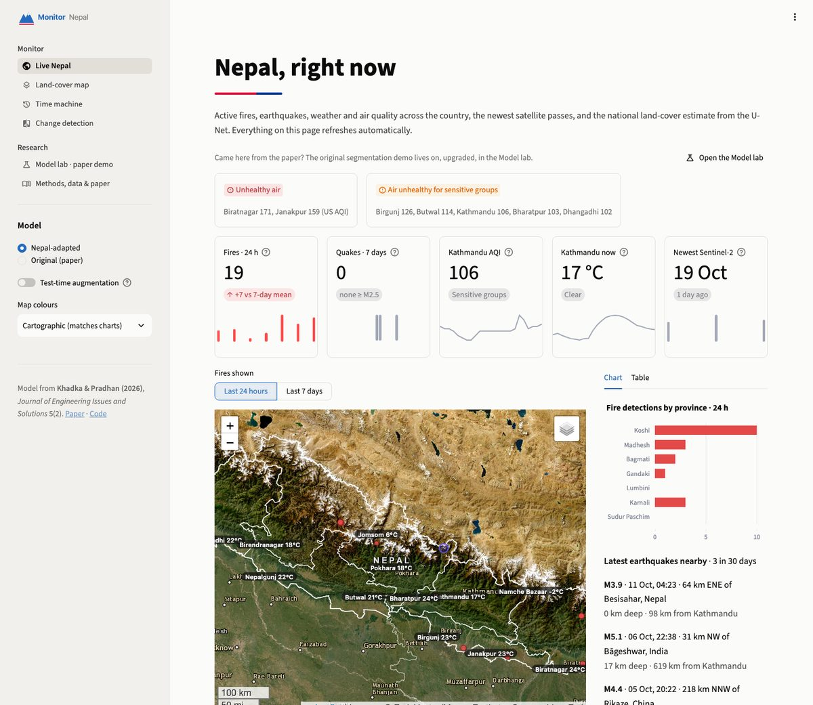
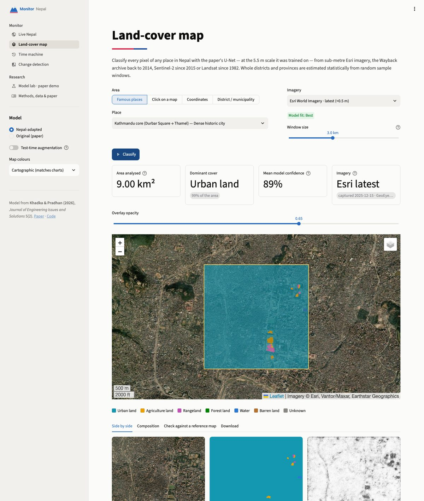
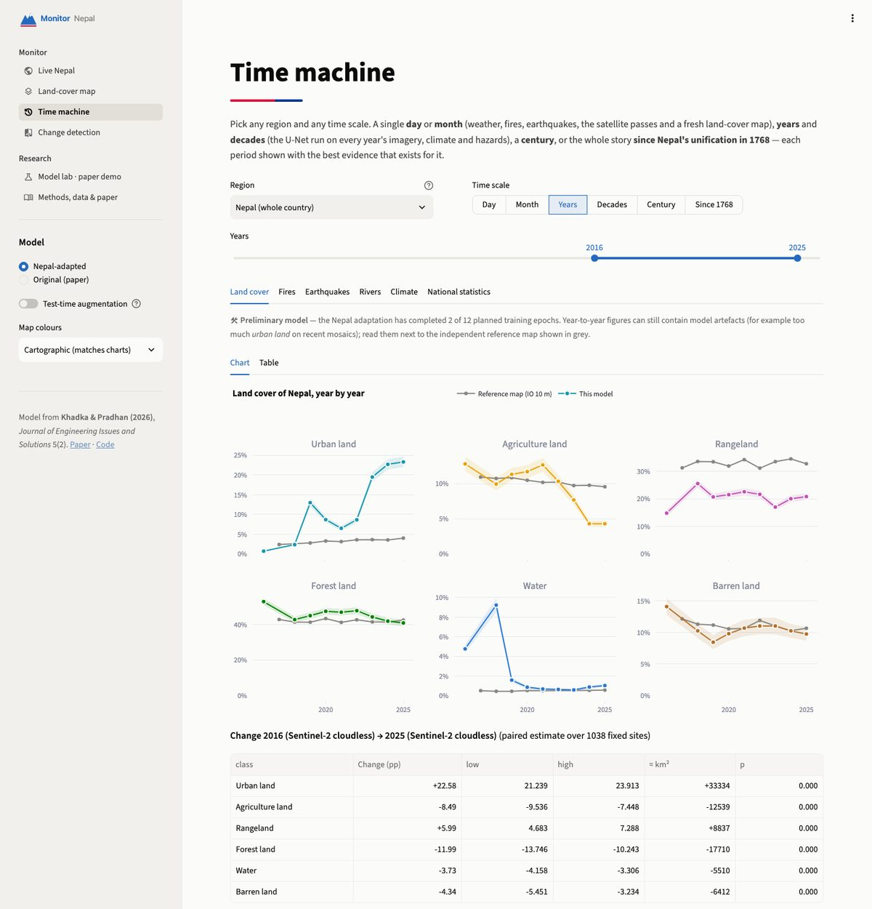
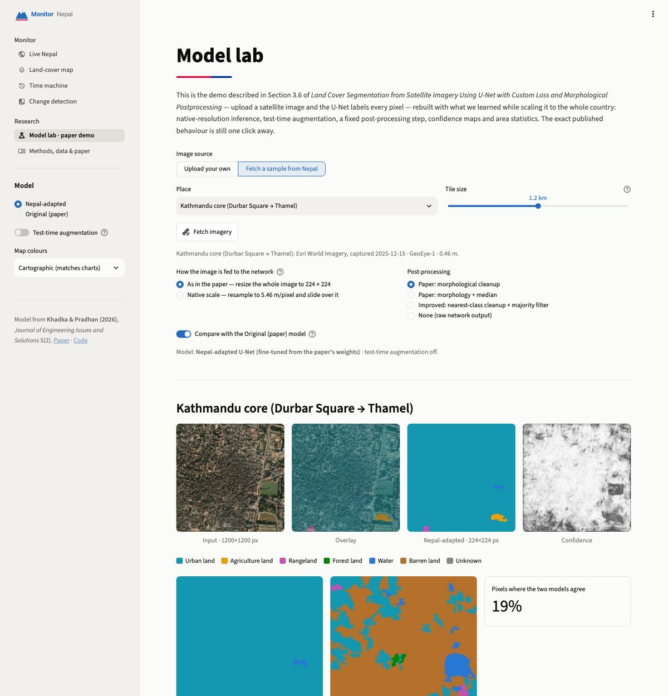

# Monitor Nepal — AI land-cover observatory

**Live app:** https://4classifying-every-pixel-of-the-planets.streamlit.app/
**Paper:** Khadka, Y. & Pradhan, R. (2026). *Land Cover Segmentation from Satellite Imagery Using U-Net with Custom
Loss and Morphological Postprocessing.* Journal of Engineering Issues and Solutions 5(2): 240–253.
[doi:10.3126/joeis.v5i2.97825](https://doi.org/10.3126/joeis.v5i2.97825)

Monitor Nepal turns the paper's U-Net into a monitoring system for the whole country. It classifies every pixel of
any place in Nepal from sub-metre or satellite imagery of any date since 1972, estimates land cover for every
district and province with confidence intervals, follows it year by year, and sets it beside live fires,
earthquakes, weather, air quality and two and a half centuries of history.

<p align="center">
  
  
  
  
</p>

## What you can do

| Page | What it shows |
|---|---|
| **Live Nepal** | Alerts (unhealthy air, unusual fire activity, significant earthquakes, heavy-rain forecasts, river flood watch), active fires (last 24 h / 7 days), earthquakes, weather and air quality in 12 cities, flow and 7-day forecast of the six major rivers against their normal range, the newest Sentinel-2 passes, today's NASA true-colour image and night lights, and the national land-cover estimate with a district map. Refreshes every 10 minutes. |
| **Land-cover map** | The U-Net on any place: famous places, a click on the map, coordinates, or any of the 860 provinces, districts and municipalities. Imagery: Esri latest (≈0.5 m), the Esri Wayback archive (197 versions since 2014, with real capture dates), Sentinel-2 cloudless annual mosaics (2016, 2018–2025), Sentinel-2 for any date since 2015, Landsat since 1982. Large regions are estimated from random sample windows with 95% confidence intervals. Downloads: GeoTIFF (colour table embedded), PNG + world file, CSV. |
| **Time machine** | One region, any time scale: a **day** (hourly weather, fires, earthquakes, river flows, that day's satellite images, a fresh land-cover map), a **month** (daily weather vs previous years, fires, satellite passes, land cover, snow cover and vegetation greenness from Sentinel-2), **years** (land cover every year 2016–2025 — 2017's mosaic is blank over Nepal — vs an independent reference map, fires, earthquakes, river peaks, climate, national statistics), **decades** (Landsat land cover, climate since 1901, people & land), a **century**, or **since 1768** — the unification of Nepal — with each era labelled by the evidence that exists for it. |
| **Change detection** | The same place at two dates on an identical 5.5 m grid: drag-to-compare imagery and maps, where it changed (new built-up land, forest loss, water), how much (net change, Sankey of transitions), largest change patches. |
| **Model lab** | The paper's demo (Sec. 3.6), reproduced exactly and upgraded: upload images or fetch samples from Nepal, paper-style 224 × 224 or native-scale inference, test-time augmentation, the published or the corrected post-processing, confidence maps, areas. |
| **Methods, data & paper** | Citation and BibTeX, model card, the findings below, the statistics, every data source and its licence, limitations. |

## How it works

```
imagery (Esri / Wayback / Sentinel-2 / Landsat, any date)
   │  fetched at ~1 m and sampled to 5.46 m/pixel exactly as in training (OpenCV-style bilinear, no antialiasing)
   ▼
U-Net (the paper's weights, or the Nepal-adapted fine-tune) on ONNX Runtime
   │  512-px sliding windows, 64-px overlap, linear blending; optional 4-view test-time augmentation
   ▼
post-processing: regions < 64 px take the class of the nearest surviving region
   ▼
areas with true per-row ground pixel size · design-based estimates for large regions · paired change over time
```

**Four findings from scaling the model up** (details on the *Methods* page):

1. **The network depends on how images are shrunk.** Training used `cv2.resize` (bilinear without antialiasing),
   which keeps a sparse sample of the 0.5 m texture. On 40 DeepGlobe tiles, forest IoU is **0.58** with that resize
   and **0.00** with an antialiased one (mean IoU 0.62 vs 0.39). About 1 m source imagery works as well as 0.5 m;
   2 m loses most forest. The app re-implements OpenCV's sampling in NumPy (≤ 1 grey level difference).
2. **A post-processing quirk.** The published cleanup never re-assigns the specks it removes, so they become class 0,
   *Urban land*. The paper options in the Model lab reproduce `legacy/app_alpha.py` bit-for-bit (verified against
   scikit-image 0.21); everywhere else removed specks take the nearest surviving class.
3. **Annual mosaics need radiometric normalisation.** The yearly Sentinel-2 cloudless mosaics differ in colour
   processing (national mean red 63–95 across years); without correction the network reports processing changes as
   land-cover change. Each year is mapped onto the 2018–2025 average (per-channel gain and offset).
4. **The domain gap the paper predicted is large** — so the model was fine-tuned for Nepal (next section).

## The Nepal-adapted model

The paper's conclusion names the missing piece: labelled Nepalese imagery. `scripts/build_nepal_dataset.py` builds it
automatically — sites in all 77 districts plus targeted urban and river sites; 224 × 224 patches at 5.46 m from Esri
World Imagery, Sentinel-2 cloudless mosaics, Sentinel-2 seasonal mosaics and Landsat 8/9, paired with *weak labels*
from the Impact Observatory 10 m land-cover map of the same year translated to the seven DeepGlobe classes. Eleven
whole districts are held out. `scripts/finetune_nepal.py` fine-tunes the same architecture from the paper's weights
with the paper's own loss (0.4 × weighted cross-entropy + 0.6 × focal Tversky) and exports ONNX plus a `.keras` file
(`models/deepglobe_unet_nepal.keras`) that loads in Keras exactly like the original.

<!-- EVALUATION -->

**Held-out evaluation** — 220 random 1.22 km windows in 11 districts held out from training (Dhanusa, Ilam, Jumla, Kailali, Kaski, Lalitpur, Mustang, Rasuwa, Rupandehi, Sunsari, Surkhet); imagery and references from 2021; pixels the references mark as cloud/no-data excluded.

| Imagery | Reference | Original model | Nepal-adapted |
|---|---|---|---|
| Esri World Imagery (latest) | ESA WorldCover 2021 | 38% (κ 0.24, mIoU 0.20) | 72% (κ 0.60, mIoU 0.44) |
| Esri World Imagery (latest) | Impact Observatory 2021 | 39% (κ 0.25, mIoU 0.22) | 82% (κ 0.75, mIoU 0.60) |
| Landsat 8, Oct-Dec 2021 | ESA WorldCover 2021 | 2% (κ 0.00, mIoU 0.01) | 66% (κ 0.48, mIoU 0.35) |
| Landsat 8, Oct-Dec 2021 | Impact Observatory 2021 | 2% (κ 0.00, mIoU 0.02) | 70% (κ 0.57, mIoU 0.42) |
| Sentinel-2 L2A, Oct-Dec 2021 | ESA WorldCover 2021 | 19% (κ 0.11, mIoU 0.11) | 75% (κ 0.64, mIoU 0.46) |
| Sentinel-2 L2A, Oct-Dec 2021 | Impact Observatory 2021 | 20% (κ 0.11, mIoU 0.11) | 79% (κ 0.72, mIoU 0.56) |
| Sentinel-2 cloudless 2021 | ESA WorldCover 2021 | 3% (κ 0.01, mIoU 0.02) | 72% (κ 0.61, mIoU 0.46) |
| Sentinel-2 cloudless 2021 | Impact Observatory 2021 | 2% (κ 0.00, mIoU 0.03) | 76% (κ 0.67, mIoU 0.52) |

Pixel agreement (Cohen's κ, mean IoU over the six land classes). For scale, the two reference maps agree with each other on 77% of the same pixels (κ 0.67) — the practical ceiling for any model scored against them. Impact Observatory also supplied the training labels, so ESA WorldCover is the fairer test.

Validation mean IoU against the weak labels on the held-out districts: 0.111 for the original weights → 0.553 after fine-tuning (12 epochs from the paper's weights, best at epoch 10 with 0.490, then a 100-epoch continuation, best at epoch 92, on a free Kaggle Tesla T4 GPU).

<!-- /EVALUATION -->

## Run it locally

```bash
python -m venv .venv && source .venv/bin/activate      # Python 3.11+
pip install -r requirements.txt
streamlit run app_alpha.py
```

Optional: copy `.streamlit/secrets.toml.example` to `.streamlit/secrets.toml` and add a free NASA FIRMS key to fill
fire records between 1 January and seven days ago for the current year.

## Deploying without changing the paper's link

The URL printed in the paper belongs to the Streamlit Community Cloud app that runs **`app_alpha.py`** from the
**`main`** branch of [`yamrajkhadka/project_on_img_seg_using_unet_archi`](https://github.com/yamrajkhadka/project_on_img_seg_using_unet_archi).
Pushing this code to that branch updates the app in place: same URL, same Python version, new app. The original demo
is kept verbatim in `legacy/`, and the notebooks and `deepglobe_unet_jay.keras` stay where the paper says they are.
TensorFlow is no longer needed at runtime, so the app installs and starts much faster.

**It keeps itself up to date.** The live panels (fires, earthquakes, weather, air quality, rivers, satellite passes)
are fetched fresh on every visit. Once a month, `.github/workflows/refresh-atlas.yml` adds every newly published year
(the next Sentinel-2 cloudless annual mosaic and the next 10 m reference map, found by `scripts/extend_years.py`),
classifies the atlas sites for it, re-classifies the latest high-resolution imagery and commits the result, which
redeploys the app, so the year-by-year timeline grows by itself. A day after, `.github/workflows/tests.yml` also
checks every live data source and GitHub emails the owner if one has changed. `requirements.txt` pins the exact
library versions that are known to work, so a restart years from now installs the same environment.

## Reproduce the research

| Script | Purpose |
|---|---|
| `scripts/convert_to_onnx.py` | Export the Keras model to ONNX with dynamic image size and verify it (needs TensorFlow). |
| `scripts/build_nepal_dataset.py` | Build the weakly-labelled Nepal dataset (train / held-out validation). |
| `scripts/finetune_nepal.py` | Fine-tune on it (PyTorch twin of the Keras network; CUDA, Apple MPS or CPU). |
| `scripts/evaluate_models.py` | Score both models on held-out districts against two independent reference maps. |
| `scripts/build_atlas.py` | Build or extend the national atlas (fixed stratified panel of sites, every epoch). |
| `scripts/extend_years.py` | Add newly published years (Sentinel-2 cloudless mosaic, reference map); run monthly. |
| `scripts/build_history.py` | Refresh the bundled long-run national series. |
| `scripts/build_rivers.py` | Rebuild the 2004–2023 river climatology and flood levels. |
| `scripts/prepare_boundaries.py` | Simplify the official administrative boundaries. |
| `scripts/unet_torch.py` | PyTorch twin of the paper's U-Net with Keras weight import/export. |

Research dependencies: `pip install -r requirements-research.txt`. Tests: `pytest -q` (offline) and
`MONITOR_NEPAL_NETWORK_TESTS=1 pytest -q tests/test_network.py` (live services).

## Repository layout

```
app_alpha.py, app.py          Streamlit entry points (app_alpha.py is the one the paper's URL runs)
monitor_nepal/                the library: model, imagery, live feeds, history, analysis, UI
views/                        the six pages
models/                       ONNX models (+ the Nepal-adapted .keras), training log, evaluation
data/                         boundaries, national atlas, bundled history snapshots
scripts/                      research and data pipelines
legacy/                       the original demo (app_alpha.py, app.py), unchanged
*.ipynb, deepglobe_unet_jay.keras, class_dict.csv   the paper's training code and model, unchanged
```

## The model (from the paper)

U-Net from scratch: encoder 32-64-128-256 filters, bottleneck 512 with dropout 0.5, decoder with transposed
convolutions and skip connections, 7.77 M parameters; trained on the DeepGlobe Land Cover dataset (803 tiles,
2448 px at 0.5 m resized to 224 px) with Albumentations augmentation and 0.6 × focal Tversky + 0.4 × weighted
categorical cross-entropy.

| ID | Class | DeepGlobe colour | IoU (paper, Table 3) |
|---|---|---|---|
| 0 | Urban land | (0, 255, 255) | 0.72 |
| 1 | Agriculture land | (255, 255, 0) | 0.72 |
| 2 | Rangeland | (255, 0, 255) | 0.35 |
| 3 | Forest land | (0, 255, 0) | 0.72 |
| 4 | Water | (0, 0, 255) | 0.66 |
| 5 | Barren land | (255, 255, 255) | 0.57 |
| 6 | Unknown | (0, 0, 0) | 0.98 |

Mean IoU 0.67 as reported; in the notebook it is computed over all 803 tiles (training and validation split), and the
validation mean IoU logged during training was about 0.60.

## Data sources

Esri World Imagery and Wayback · EOX Sentinel-2 cloudless (CC BY-NC-SA 4.0; 2016 CC BY 4.0) · Copernicus Sentinel-2
and USGS Landsat via Microsoft Planetary Computer · NASA GIBS · Impact Observatory/Esri 10 m LULC (CC BY 4.0) ·
ESA WorldCover (CC BY 4.0) · NASA FIRMS · USGS ComCat · Open-Meteo (ERA5, CAMS, GloFAS; CC BY 4.0) · World Bank WDI and
CCKP (CRU TS 4.08, ERA5) · HYDE 3.3 via Our World in Data · OCHA COD-AB boundaries from the Survey Department of
Nepal (CC BY-IGO). Imagery and derived data stay under their providers' terms; the weakly-labelled dataset and the
fine-tuned model are for research and non-commercial use.

## Cite

```bibtex
@article{khadka2026landcover,
  title   = {Land Cover Segmentation from Satellite Imagery Using U-Net with Custom Loss and Morphological Postprocessing},
  author  = {Khadka, Yamraj and Pradhan, Rajat},
  journal = {Journal of Engineering Issues and Solutions},
  volume  = {5},
  number  = {2},
  pages   = {240--253},
  year    = {2026},
  doi     = {10.3126/joeis.v5i2.97825}
}
```
